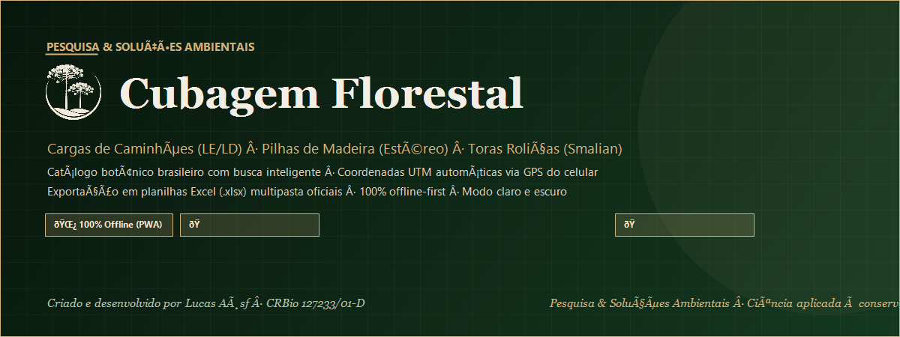

  

# Cubagem Florestal

App de cubagem florestal e dendrometria para o trabalho de campo — **Pesquisa & Soluções Ambientais**, criado por **Lucas Aøsf**.

**[Abrir o app](https://lucasaosf.github.io/cubagem-florestal/)** · [Política de privacidade](https://lucasaosf.github.io/cubagem-florestal/privacidade.html)

## O que o app faz

- **Cargas de caminhões**: medição de ambos os lados (Lado Esquerdo e Lado Direito) com alturas dinâmicas, cálculo de altura média ponderada e volume geométrico.
- **Pilhas de madeira**: medição prática em face única com número flexível de alturas verticais e cálculo de volume estéreo.
- **Toras roliças individuais (Fórmula de Smalian)**: cubagem individual de toras com diâmetro das pontas (fina e grossa), comprimento, número de plaqueta e espécie botânica, com somatório automático do volume de toda a pilha.
- **Catálogo botânico brasileiro**: busca inteligente por nome popular (sem hífens) ou nome científico, cobrindo espécies nativas e exóticas da flora do Brasil (Sistaxon / Sinaflor / Flora do Brasil) e identificação de origem.
- **Informações da operação simplificadas**: data, hora, local/pátio, km/localização com suporte a caracteres e estacas (ex: `37 + 150 Norte`), coordenadas UTM automáticas via GPS do celular e observações de campo.
- **Exportação em planilha Excel oficial**: arquivo `.xlsx` multipasta (Resumo, Caminhões, Pilhas de Madeira e Toras Roliças) estilizado na identidade visual verde floresta e ouro, com tipografia Century Gothic e fórmulas matemáticas oficiais.
- **Modo claro e escuro**, funciona **100% sem internet (Offline-First)** no Android, iPhone e computador.

## Telas

<table>
  <tr>
    <td align="center" width="33%"> Início e Modalidades</td>
    <td align="center" width="33%"> Modo Claro</td>
    <td align="center" width="33%"> Planilha Oficial .xlsx</td>
  </tr>
</table>

## Planilha de cubagem e dendrometria

Gera planilhas oficiais com abas separadas para cada modalidade operacional:
- **Resumo Executivo**: totalizador consolidado com indicadores de volume total (m³), volume médio por carga e contadores de caminhões, pilhas e toras.
- **Caminhões**: tabela completa com placa, origem da madeira (nativa/exótica), alturas LE e LD, Hm média, dimensões geométricas e volume total.
- **Pilhas de Madeira**: registro detalhado de cada pilha, alturas medidas na face única, comprimento, profundidade e volume estéreo.
- **Toras Roliças (Smalian)**: discriminação de cada indivíduo com número da plaqueta, espécie florestal individual, diâmetros das pontas ($d_1$ e $d_2$), diâmetro médio, comprimento, volume Smalian individual e subtotal automático por lote/pilha.

## Instalar

- **Android:** abra o app no **Chrome** e toque em **Instalar app** (ou ⋮ → *Adicionar à tela inicial*).
- **iPhone:** abra o app no **Safari** → **Compartilhar** → *Adicionar à Tela de Início*.

As medições ficam salvas no celular (IndexedDB offline) e o app funciona sem internet depois de aberto uma vez.

Dados mostrados nas imagens são de exemplo.

---

<i>Pesquisa &amp; Soluções Ambientais</i> · ciência aplicada à conservação
